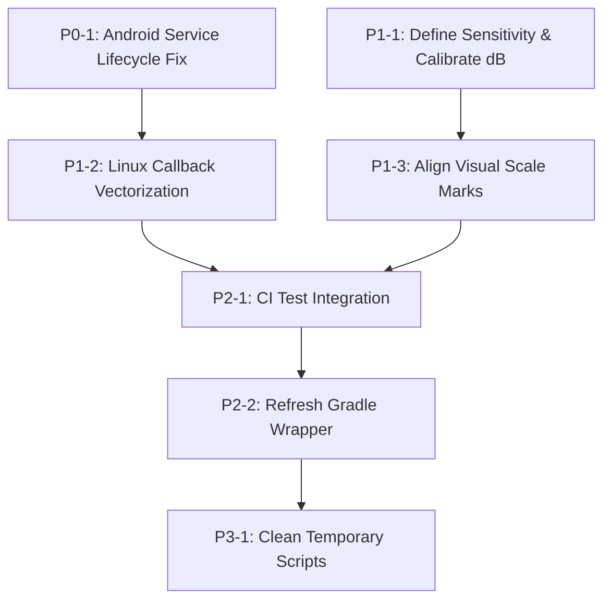

# Stereo VU – Comprehensive Architecture, Audio Engineering and Quality Audit Report

**Repository:** `felhosip-web/stereo-vu`
**Audited Commit SHA:** `42a008c92ff9c0dbe15ff28379345f498ed89718`
**Base Commit SHA:** `42a008c92ff9c0dbe15ff28379345f498ed89718`
**Audit Branch:** `docs/comprehensive-stereo-vu-audit-15387933856861839179`
**Audit Date:** November 8, 2026
**Auditor:** Jules (Senior Software & Audio DSP Engineer)

---

## 1. Executive Summary

This document presents a comprehensive, evidence-based technical audit of the **Stereo VU** multi-platform metering project across its Android (`app/`), Linux (`linux/`), and Web (`src/`) implementations. The audit investigates overall software architecture, audio acquisition lifecycle, digital signal processing (DSP) correctness, True Peak interpolation standards compliance, ballistics response, display and rendering performance, settings persistence, test suites, and CI/CD pipelines.

### Key Conclusions
1. **Fundamental Architecture:** The project features a well-conceived cross-platform design providing responsive stereo level visualization on Android (Kotlin floating overlay) and Linux (PyQt6 borderless desktop widget). However, notable architectural weaknesses exist in lifecycle management and thread synchronization in Android's `FloatingVuService` and callback memory allocation risks in Linux's `stereo_vu.py`.
2. **Audio Measurement & DSP Correctness:** The polyphase True Peak implementation computes a 4× inter-sample oversampled estimate (generating an effective 192 kHz rate from 48 kHz, or 176.4 kHz from 44.1 kHz) using a 48-tap linear-phase FIR filter structure with unity DC gain across sub-phases. However, its filter coefficients differ from the reference 48-coefficient interpolator published in ITU-R BS.1770-5 Annex 2. Because no formal frequency response or step-response equivalence has been documented or validated, standards compliance is currently unverified. The meter should be formally classified as a **custom 4× oversampled inter-sample peak estimate** until equivalence or superior performance is demonstrated.
3. **Decibel Scaling and Display Multiplier:** Both Android (`StereoVuView.kt`) and Linux (`stereo_vu.py`) apply a hardcoded $3.0\times$ display multiplier ($\approx +9.542\text{ dB}$) in `toLevel` / `to_level`, distinct from the configurable user Gain control (which already exists in settings on both platforms). While this multiplier was likely introduced to boost visual meter activity for low-level audio, it causes any input signal exceeding $-9.542\text{ dBFS}$ (at unity user Gain) to saturate at full scale ($1.0$), compressing visual display headroom. Furthermore, the numerical LCD readout is derived directly from this display/ballistics level rather than functioning as an independent, calibrated raw-PCM dBFS measurement. Any future refactoring should first clearly define intended sensitivity behavior and preserve existing user settings rather than blindly removing the display multiplier.
4. **Key Technical Findings:**
   - **ANDROID-001 (High):** Asynchronous `AudioRecord` construction after a main-thread null check creates a startup race condition. In addition, unhandled non-positive `AudioRecord.read()` return codes risk a tight loop, and releasing `AudioRecord` in `onDestroy()` without explicitly joining the worker thread introduces potential platform-specific stability risks.
   - **LINUX-001 (Medium):** Dynamic array creation and indexing (`np.arange()`, slice views) inside `linux/true_peak.py` during audio callback execution introduces memory allocation overhead and jitter risks in the high-priority real-time audio thread.
   - **DSP-001 (High):** Signal saturation above $-9.542\text{ dBFS}$ (at unity user Gain) and derivative LCD readouts resulting from the hardcoded $3.0\times$ display multiplier.
5. **Protected & High-Quality Components:**
   - Recent VFD (Theme 5) subsegment geometry and scale clamping (down to 50%) are verified correct without regressions.
   - LCD Green (Theme 6) and LCD Amber (Theme 7) seven-segment readouts, contrast, ghosting, and segment-gap rendering operate reliably across platforms.
   - Ballistics mode migration (v1 mode 3 Custom $\to$ v2 mode 7 Custom) is idempotent and verified by unit tests.

---

## 2. Repository Identity and Audited Commit SHA

- **Remote Origin URL:** `https://github.com/felhosip-web/stereo-vu`
- **Audited Commit SHA:** `42a008c92ff9c0dbe15ff28379345f498ed89718`
- **Commit Subject:** `Merge pull request #8 from felhosip-web/fix/vfd-videoton-display-consistency-5325373064350123032`
- **Commit Author:** `felhosip-web <281145541+felhosip-web@users.noreply.github.com>`
- **Working Tree State at Audit Start:** Clean, branch `docs/comprehensive-stereo-vu-audit-15387933856861839179` tracking `origin/docs/comprehensive-stereo-vu-audit-15387933856861839179`.
- **Target Pull Request:** Documentation-only pull request #9 on branch `docs/comprehensive-stereo-vu-audit-15387933856861839179`.

---

## 3. Architecture Overview

### Platform Component Breakdown
- **Android (`app/`):**
  - `MainActivity.kt`: Settings UI organized into a 4-tab tabbed dialog (Detection & Ballistics, Visual Effects, Appearance & Layout, General / Audio), handling permissions (`RECORD_AUDIO`, `SYSTEM_ALERT_WINDOW`, `POST_NOTIFICATIONS`, `FOREGROUND_SERVICE_MEDIA_PROJECTION`), and launching `FloatingVuService`.
  - `FloatingVuService.kt`: Foreground service capturing internal audio playback via `MediaProjection` and `AudioPlaybackCaptureConfiguration` (with fallback to `AudioSource.MIC`), managing a dedicated audio processing thread, sliding-window RMS calculation, and hosting `StereoVuView` as a window overlay.
  - `StereoVuView.kt`: Custom Android `View` implementing the nominally 60 FPS physics ballistics decay loop, peak tracking, layout measurement (`onMeasure`), and rendering pipelines across 8 themes.
  - `TruePeakDetector.kt`: 4× polyphase FIR interpolation filter maintaining delay history across buffers.
  - `LcdHelper.kt` / `VfdHelper.kt`: Modular rendering and layout calculations for LCD and VFD themes.
  - `BallisticsModeMigration.kt`: Migration logic for persisted ballistics modes.
- **Linux (`linux/`):**
  - `stereo_vu.py`: Single-module application incorporating PyQt6 GUI, `sounddevice`/PortAudio input stream, real-time audio callback, nominally 60 FPS `QTimer` physics loop, custom painter routines for all 8 themes, and a 4-tab `SettingsDialog`.
  - `true_peak.py`: 4× polyphase FIR True Peak detector class and `get_migrated_mode` helper.
  - `vfd_helper.py`: VFD layout and color helper functions.
- **Web (`src/`):**
  - React 19 / TypeScript / Vite application showcasing project documentation, feature guides, and simulated VU graphics.

### Separation of Concerns & Coupling
- **Android:** Good separation between DSP (`TruePeakDetector`), visual helpers (`LcdHelper`, `VfdHelper`), and view presentation (`StereoVuView`). However, audio acquisition (`FloatingVuService`) and ballistics integration are partially entangled: `FloatingVuService` computes raw buffer peak or sliding-window RMS and posts values to `StereoVuView.updateLevels()`, where decibel conversion and follower attack/decay take place.
- **Linux:** `stereo_vu.py` concentrates multiple responsibilities within `StereoVuWidget`, which manages the PortAudio stream, processes incoming buffers, runs the animation loop, manages settings, and executes custom painter drawing routines.

---

## 4. Android Audit

### AudioRecord Lifecycle & Foreground Service
- **Service Configuration:** `FloatingVuService` correctly configures foreground service types in `AndroidManifest.xml` and code:
  ```xml
  <service android:name=".FloatingVuService"
           android:foregroundServiceType="mediaProjection|mediaPlayback"
           android:exported="false" />
  ```
  On Android 14 (API 34), both `FOREGROUND_SERVICE_TYPE_MEDIA_PROJECTION` and `FOREGROUND_SERVICE_TYPE_MEDIA_PLAYBACK` are correctly flagged.
- **Notification Controls:** A persistent notification on `vu_channel` includes a `PendingIntent` triggering `ACTION_STOP` to cleanly terminate the service.
- **Concurrency & Race Conditions:**
  - In `startAudioCapture(captureIntent)`:
    ```kotlin
    if (audioRecord != null) return
    thread {
        try {
            ...
            audioRecord = AudioRecord.Builder()...build()
    ```
    The null-check is performed on the main thread, but `audioRecord` is instantiated asynchronously inside the worker thread. If `onStartCommand` is invoked twice rapidly (e.g., rapid service restarts or configuration toggles), two concurrent threads could be spawned, leading to duplicate `AudioRecord` allocations and thread management conflicts.
- **Error Handling & Thread Lifecycle Risks:**
  - In the audio capture loop:
    ```kotlin
    val read = audioRecord?.read(buffer, 0, buffer.size) ?: 0
    if (read > 0) { ... }
    ```
    If an audio device is disconnected, the audio server encounters an issue, or capture is interrupted, `AudioRecord.read()` may return non-positive status codes:
    - `0` (no data read)
    - `AudioRecord.ERROR_INVALID_OPERATION` ($-3$)
    - `AudioRecord.ERROR_BAD_VALUE` ($-2$)
    - `AudioRecord.ERROR_DEAD_OBJECT` ($-6$)
    Because non-positive return values are not explicitly handled or backed off, the `while (running)` loop risks spinning in a tight loop without pause or recovery attempt.
  - In `onDestroy()`:
    ```kotlin
    running = false
    audioRecord?.stop()
    audioRecord?.release()
    audioRecord = null
    ```
    `running = false` is signaled without explicit memory synchronization or waiting for the worker thread to exit (`thread.join()`). Calling `audioRecord?.stop()` and `audioRecord?.release()` while the worker thread may still be blocked in a synchronous `read()` call presents a platform-specific stability risk on certain Android HAL implementations (where concurrent release during active read can trigger native client-side aborts). A robust teardown should signal the stop condition, ensure worker visibility, join the worker thread with a reasonable timeout, and then release recorder resources.

---

## 5. Linux Audit

### PortAudio / sounddevice Stream Management
- **Input Stream Initialization:**
  In `stereo_vu.py`, `start_stream()` properly checks for available input devices and uses `sd.InputStream(device=device_index, callback=self.audio_callback, channels=2, samplerate=self.sample_rate)`.
  If device opening fails, it catches `Exception`, logs the error, falls back to the default device, and gracefully switches to a simulated demo mode if no hardware device is available.
- **Audio Callback Performance & Safety Risks:**
  The PortAudio callback executes in a high-priority real-time audio thread:
  ```python
  def audio_callback(self, indata, frames, time, status):
      if self.mode == 3 and frames > 0:
          peak_l, peak_r = self.true_peak_detector.process_buffer(indata[:, 0], indata[:, 1])
  ```
  - **Memory Allocations in Audio Callback:** In `linux/true_peak.py`:
    ```python
    idx = (self.head - np.arange(TAPS)) % TAPS
    hist_l = self.delay_l[idx]
    p1_l = abs(np.dot(hist_l, PHASE_1))
    ```
    Within `process_sample()`, calling `np.arange(TAPS)` and using advanced array indexing constructs temporary NumPy array objects repeatedly during audio processing. In real-time audio programming, heap memory allocations within the callback thread represent a known performance and jitter risk that could lead to audio underruns under high system load. While audible stutter or buffer overflows have not been established through empirical profiling in this test environment, optimizing buffer processing (e.g., vectorizing operations across the chunk or utilizing fixed-size pre-allocated circular buffers) is a recommended proactive improvement.
- **Stream Teardown:**
  In `closeEvent()`, `self.stream.stop()` and `self.stream.close()` are invoked cleanly before widget destruction.

---

## 6. DSP and Measurement Accuracy Audit

### True Peak Implementation and ITU-R BS.1770
The project implements a 4× polyphase FIR oversampling structure with 12 taps per sub-phase (48 taps total):
$$\text{PHASE\_0} = [0, 0, 0, 0, 0, 1.0, 0, 0, 0, 0, 0, 0]$$
$$\text{PHASE\_1} = [-0.00040574, \dots, 0.88354769, 0.29451590, \dots]$$
$$\text{PHASE\_2} = [-0.00054430, \dots, 0.62085649, 0.62085649, \dots]$$
$$\text{PHASE\_3} = [-0.00037046, \dots, 0.29451590, 0.88354769, \dots]$$

With 4× oversampling, the effective reconstruction rate is **192 kHz** for a **48 kHz** input stream, and **176.4 kHz** for a **44.1 kHz** input stream.

#### Technical Analysis:
1. **DC Unity Gain:**
   $$\sum \text{PHASE\_1} = 1.00000000$$
   $$\sum \text{PHASE\_2} = 0.99999998$$
   $$\sum \text{PHASE\_3} = 1.00000000$$
   DC gain across each polyphase sub-filter evaluates to $1.0000\ (0.00\text{ dB})$.
2. **Symmetry & Linear Phase:**
   The impulse response across the phases exhibits linear-phase symmetry, and Phase 0 acts as a pure pass-through delay for original sample points, preserving input samples at integer sampling intervals.
3. **ITU-R BS.1770-5 Annex 2 Comparison:**
   The current international recommendation is **ITU-R BS.1770-5**. Annex 2 of BS.1770-5 provides a specific reference set of 48 filter coefficients for 4× oversampling at 48 kHz.
   - The filter coefficients used in `TruePeakDetector.kt` and `true_peak.py` differ from the published BS.1770-5 Annex 2 reference coefficients.
   - This difference in coefficients alone does not constitute proof of either failure or compliance, as alternative FIR designs can achieve valid interpolation.
   - However, because no reproducible frequency-response calculation, passband ripple measurement, or stopband attenuation analysis across specified frequency ranges is currently documented for these coefficients, **formal standards compliance remains unverified**.
   - Consequently, the meter cannot legitimately claim verified ITU-R BS.1770 compliance at this stage. It should be classified and documented as a **custom 4× oversampled inter-sample peak estimate** until full numerical equivalence or superior performance against the reference specification is demonstrated.

### Signal Chain: Gain, dBFS, and the $3.0\times$ Display Multiplier
To assess level calculations accurately, it is essential to trace the distinct stages of the signal pipeline:
1. **Normalized Input PCM:** Raw audio samples in the range $[-1.0, +1.0]$, representing signal level relative to 0 dBFS.
2. **Configurable User Gain:** A user-adjustable sensitivity parameter (`gain` in Android, `gain` / `digital_gain` in Linux) accessible in Tab 4 / Section 4 of the settings UI (adjustable from $0.01\times$ to $3.0\times$, default $1.0\times$).
3. **Fixed Display Multiplier:** A fixed, hardcoded $3.0\times$ multiplier applied in the display transfer function (`toLevel` / `to_level`):
   $$20 \log_{10}(3.0) \approx +9.542\text{ dB}$$
4. **Display Level:** The instantaneous un-smoothed level computed via the 50 dB range transfer function:
   $$\text{level}_{\text{raw}} = \frac{20 \log_{10}(\text{PCM} \times 3.0 \times \text{gain}) + 50}{50}, \quad \text{clamped to } [0.0, 1.0]$$
5. **Ballistics-Smoothed Level:** The smoothed bar value resulting from the attack and decay filter updates.
6. **Numerical LCD Readout:** The digital readout rendered in Themes 6 and 7:
   $$\text{readout\_dB} = (\text{display\_level} \times 50) - 50$$
   Crucially, this numerical readout is derived directly from the ballistics-smoothed display level. It is **not** an independent calibrated raw-PCM dBFS meter.

#### Implications of the Fixed Multiplier:
- **Headroom Saturation:** At unity user Gain ($\text{gain} = 1.0$), any input signal with peak linear amplitude $A \ge \frac{1}{3} \approx 0.3333$ (i.e., **$-9.542\text{ dBFS}$**) causes the transfer function argument to reach $1.0$, resulting in a clamped display level of $1.0$ (100% full scale). Signals between $-9.542\text{ dBFS}$ and $0\text{ dBFS}$ therefore saturate the meter display.
- **Readout Offset:** Because the LCD readout is mapped directly from this display level, an input tone of $-20.0\text{ dBFS}$ produces an indicated readout of approximately $-10.5\text{ dB}$.
- **Remediation Caution:** A dedicated user Gain slider already exists in both applications. Developers should **not** add another slider or blindly delete the fixed multiplier without first defining the intended default sensitivity behavior (e.g., standardizing whether 0 dB on the visual scale represents digital full-scale 0 dBFS or an analog-style alignment level such as $-10\text{ dBFS}$ / $-18\text{ dBFS}$), while ensuring existing user settings and expectations are preserved.

### Dynamic Range vs. Scale Markings
The physical scale markings in `drawScale()`:
- `0 dB`: index `ledCount - 1` ($1.00 \times \text{height}$)
- `-3 dB`: index `ledCount * 0.91` ($0.91 \times \text{height}$)
- `-6 dB`: index `ledCount * 0.85` ($0.85 \times \text{height}$)
- `-10 dB`: index `ledCount * 0.65` ($0.65 \times \text{height}$)
- `-20 dB`: index `ledCount * 0.35` ($0.35 \times \text{height}$)

However, according to the linear-in-dB transfer function $\text{level} = \frac{\text{dB} + 50}{50}$:
- At $-3\text{ dB}$, $\text{level} = \frac{47}{50} = 0.94$ (mark is painted at $0.91$)
- At $-6\text{ dB}$, $\text{level} = \frac{44}{50} = 0.88$ (mark is painted at $0.85$)
- At $-10\text{ dB}$, $\text{level} = \frac{40}{50} = 0.80$ (mark is painted at $0.65$)
- At $-20\text{ dB}$, $\text{level} = \frac{30}{50} = 0.60$ (mark is painted at $0.35$)

The tick mark distribution reflects a compressed, non-linear progression reminiscent of vintage analog VU meters, whereas the internal code calculates a strictly linear-in-dB bar height.

---

## 7. Ballistics Audit

The application supports 8 ballistics modes (indices 0 to 7) across Android and Linux:

| Mode ID | Name | Per-Update Attack Param | Per-Update Decay Param | Characteristic Behavior |
| :--- | :--- | :--- | :--- | :--- |
| **0** | Digital Peak | $0.90$ | $0.12$ | Rapid per-frame rise, fast follower decay. |
| **1** | Analog VU | Spring: user setting (def $0.15$), Damp: def $0.35$ | $2^{\text{nd}}$-order resonant spring-mass simulation | Resonant needle ballistics allowing dynamic overshoot. |
| **2** | PPM | $0.40$ | $0.08$ | Single-pole smoothing filter follower. |
| **3** | True Peak | $0.95$ | $0.15$ | Fast rise tracking 4× oversampled inter-sample peaks. |
| **4** | Classic VU | Spring: $0.10$, Damp: $0.32$ | $2^{\text{nd}}$-order resonant simulation | Moderated spring dynamic tuned for classic VU needle feel. |
| **5** | BBC PPM | $0.45$ | Stepped release: drops $\max(0.008, 0.05 \times \text{level})$ every 3 updates | Emulates mechanical stepped decay characteristic of Type IIa meters. |
| **6** | Nordic / DIN | $0.55$ | $0.14$ | Fast attack parameter with moderate linear decay. |
| **7** | Custom | Configurable attack ($0.05$ – $1.0$) | Configurable decay ($0.01$ – $0.99$) | User-defined per-update filter coefficients. |

### Ballistics Parameters and Standards Compliance:
- **Dimensionless Coefficients:** Attack and decay parameters in the codebase (e.g., $0.40$, $0.55$) are **dimensionless per-update coefficients**, not millisecond time units.
- **Update Rate Dependency:** The display loop runs at a nominal 60 FPS, but UI timer scheduling and rendering intervals vary depending on platform load, thread scheduling, and VSYNC.
- **Time Constant Conversion:** A dimensionless coefficient $\alpha$ can only be converted to an estimated physical time constant $\tau$ if the exact update interval $\Delta t$ is known:
  $$\tau \approx -\frac{\Delta t}{\ln(1 - \alpha)}$$
  Such mathematical conversions do not, on their own, establish compliance with formal broadcast standards (such as ANSI C16.5, IEC 60268-10, IEC 60268-17, or DIN 45406). Claims of formal compliance cannot be made without empirical, laboratory step-response measurements (e.g., verifying response to 5 kHz tone bursts of specified durations).

### Peak Hold & "Peak Never Below Bar"
- Peak hold logic operates within the animation loop: when `displayLevel >= peak`, peak holds for `peak_hold_ms` (default 900 ms) before decaying at the configured `peak_decay` rate.
- **Rule Verification:** The setting `peak_never_below_bar` (default `true`) ensures that peak indicator levels never fall below the current bar level (`peakL = max(peakL, displayLevelL)`), preventing detached peak markers during transients.

---

## 8. Display and Rendering Audit

### Themes & Geometry
- **Classic LED Themes (0–4):**
  - Theme 0: Classic Green-Orange-Red
  - Theme 1: Cyberpunk (Neon Cyan-Magenta)
  - Theme 2: Fire (Yellow-Orange-Red)
  - Theme 3: Ice (Turquoise-Blue-White)
  - Theme 4: Sunset (Gold-Orange-Pink)
  Segment dimensions scale cleanly across scale factors ($50\%$ to $200\%$).
- **VFD (Videoton) Theme (5):**
  - Features 4 subsegments per logical cell dividing width (vertical) or height (horizontal).
  - Cyan `#00D4E8` active, dark teal `#001F26` ghost.
  - Scale safety: Clamped dimensions using `max(1, int(sub_w))` and gaps with `max(1, int(round(...)))` prevent subsegments from collapsing to 0 pixels at lower scales ($50\%$).
- **LCD Themes (6: Green, 7: Amber):**
  - Green active `#33FF66`, ghost `#0D2E14`.
  - Amber active `#FFB000`, ghost `#2E1800`.
  - Seven-segment readout calculates layout bounding widths to avoid clipping in horizontal orientations.
  - User controls: `lcd_ghost_strength` ($0.0$ – $1.0$), `lcd_segment_gap` ($1.0$ – $6.0\text{ px}$), `lcd_seven_segment` (boolean), `lcd_contrast` ($0.20$ – $1.0$).
- **Rendering Performance:**
  - Android leverages hardware-accelerated `Canvas` operations with pre-allocated `Paint` instances.
  - Linux utilizes `QPainter` with Antialiasing and optimized glow rendering passes.

---

## 9. Settings and Persistence Audit

### Android SharedPreferences vs. Linux QSettings

| Setting Meaning | Android Key (`StereoVuPrefs`) | Linux Key (`StereoVU/LinuxApp`) | Parity Status |
| :--- | :--- | :--- | :--- |
| Ballistics Mode | `mode` (int) | `mode` (int) | Match |
| Migration Flag | `ballistics_v2_migrated` (bool) | `ballistics_v2_migrated` (bool) | Match |
| Theme ID | `theme_id` (int, 0–7) | `theme_id` (int, 0–7) | Match |
| LED Count | `led_count` (int, 10–40) | `led_count` (int, 10–40) | Match |
| Scale Factor | `size_scale` (float, 0.5–2.0) | `size_scale` (float, 0.5–2.0) | Match |
| Detection Mode | `detection_mode` (0: Peak, 1: RMS) | `detection_mode` (0: Peak, 1: RMS) | Match |
| RMS Window MS | `rms_window_ms` (int, 50–1000) | `rms_window_ms` (int, 50–1000) | Match |
| Peak Never Below Bar | `peak_never_below_bar` (bool) | `peak_never_below_bar` (bool) | Match |
| User Sensitivity Gain | `gain` (float, 0.01–3.0) | `gain` (float, 0.01–3.0) | Match |
| **Custom Attack** | `attack` (float $0.05$–$1.0$) | `attack_speed` (float $0.05$–$1.0$) | **Divergent Key** |
| **Custom Decay** | `decay` (float $0.50$–$0.99$) | `decay_speed` (float $0.01$–$0.50$) | **Divergent Key & Semantics** |
| LCD Ghost Strength | `lcd_ghost_strength` (float) | `lcd_ghost_strength` (float) | Match |
| LCD Segment Gap | `lcd_segment_gap` (float) | `lcd_segment_gap` (float) | Match |
| LCD 7-Segment | `lcd_seven_segment` (bool) | `lcd_seven_segment` (bool) | Match |
| LCD Contrast | `lcd_contrast` (float) | `lcd_contrast` (float) | Match |

**Analysis of Divergence:**
In Custom mode, Android persists `decay` where $\text{decaySpeed} = 1.0 - \text{decay}$ (e.g., decay $= 0.88 \implies \text{decaySpeed} = 0.12$). Linux persists `decay_speed` directly as $0.12$. Shared profile export/import would require key mapping.

---

## 10. Previously Reported Test Results

*(Note: The following test executions reflect previously reported results from the initial audit and were not rerun during this documentation-only revision).*

### Linux Test Suite (Previously Reported)
- **Command:** `QT_QPA_PLATFORM=offscreen PYTHONPATH=linux python3 -m pytest -v linux/`
- **Exit Code:** `0`
- **Summary:** **29 passed** in 0.53s (0 failed, 0 skipped).
- **Scope Covered:**
  - `test_ballistics.py`: 12 tests covering True Peak DC gains, inter-sample overshoot detection, buffer boundary continuity, channel separation, positive/negative polarity symmetry, mode migration idempotency, BBC PPM stepped decay, and peak hold.
  - `test_lcd_appearance.py`: 9 tests verifying LCD default values, contrast, ghost strength, segment gap geometry, character bitmap coverage, and horizontal/vertical readout bounds.
  - `test_vfd_appearance.py`: 8 tests verifying VFD 4-subsegment geometry, scale clamping (50%–200%), palette colors, and zero-dimension avoidance.

### Android Unit Test Suite (Previously Reported)
- **Command:** `gradle testDebugUnitTest`
- **Exit Code:** `0`
- **Summary:** **24 passed** (0 failed, 0 skipped, 23 actionable tasks executed).
- **Scope Covered:**
  - `LcdAppearanceTest.kt`: 9 tests verifying LCD segment gap, contrast, seven-segment glyph mapping, horizontal readout width, formatDb, and layout refresh decisions.
  - `TruePeakAndBallisticsTest.kt`: 7 tests verifying polyphase FIR DC gains, overshoot detection, buffer continuity, channel independence, and classic VU dynamics.
  - `VfdAppearanceTest.kt`: 8 tests verifying VFD subsegment geometry, scale factors, small dimension safety, and palette colors.

---

## 11. CI/CD and Build Reliability

### GitHub Workflows
1. **`.github/workflows/build-apk.yml`:**
   - Triggers on `push` and `workflow_dispatch`.
   - Uses `gradle/actions/setup-gradle@v3` and downloads `gradle-wrapper.jar` on the fly via `curl`.
   - **Observation:** Does not invoke `testDebugUnitTest` prior to APK generation. Pull requests can introduce unit test breakages without failing the workflow.
   - **Observation:** Workflow is not triggered on `pull_request`.
2. **`.github/workflows/build-linux.yml`:**
   - Triggers on `push: [main]`, `pull_request: [main]`, and `workflow_dispatch`.
   - Installs system dependencies (`portaudio19-dev`, `libasound2-dev`, `libqt6gui6`, etc.) and builds a standalone binary via PyInstaller.
   - **Observation:** Does not execute `pytest` before building the binary. Test regressions do not block artifact generation.

---

## 12. Repository Hygiene and Documentation

### Extraneous Files and Artifacts

| File Path | Classification | Analysis |
| :--- | :--- | :--- |
| `patch.kt` | Candidate for removal | 29-byte file containing only `package com.example.stereovu`. Unused. |
| `test.kt` | Candidate for removal | 54-byte scratchpad file (`fun main() { val x = 10f... }`). Unused. |
| `patch_linux.py` | Candidate for removal | 13.6 KB temporary patch script from earlier development. |
| `patch_linux2.py` | Candidate for removal | 2.5 KB temporary patch script. |
| `patch_service.kt` | Candidate for removal | 7.3 KB temporary service replacement script. |
| `patch_stereovu.py`| Candidate for removal | 11.0 KB temporary regex patching script. |
| `linux/stereo_vu.py.check` | Candidate for removal | One-line shell test command artifact. |
| `gradle/wrapper/gradle-wrapper.jar` | Needs replacement | Archive exhibits corrupted ZIP structure on clone. |

---

## 13. Confirmed Findings

### ANDROID-001: Race Condition & Lifecycle Synchronization Risks in `FloatingVuService`
- **Severity:** High
- **Category:** Architecture / Concurrency
- **Affected File:** `app/src/main/java/com/example/stereovu/FloatingVuService.kt`
- **Observation:**
  1. `startAudioCapture` performs a null-check `if (audioRecord != null) return` on the main thread, while `audioRecord` is instantiated asynchronously inside a background worker thread, creating a startup race condition if restarted rapidly.
  2. Non-positive return codes ($\le 0$) from `AudioRecord.read()` are not explicitly handled with back-off or termination, risking a continuous tight loop under error conditions.
  3. `onDestroy()` invokes `audioRecord?.release()` without explicitly joining the worker thread, posing a platform-specific stability risk on some HAL implementations. Worker-thread stop-state visibility and synchronization should be established before resource disposal.
- **Impact:** Potential UI unresponsiveness, battery drain, or unexpected service termination under device disconnection or rapid restarts.
- **Remediation:** Introduce thread synchronization, set an atomic flag before thread creation, join the worker thread with a timeout in `onDestroy()`, and add back-off handling when `read()` returns error codes.

### DSP-001: Signal Saturation and LCD Readout Distortion via $3.0\times$ Display Multiplier
- **Severity:** High
- **Category:** Audio DSP / Measurement Correctness
- **Affected Files:**
  - `app/src/main/java/com/example/stereovu/StereoVuView.kt` (`toLevel`)
  - `linux/stereo_vu.py` (`to_level`)
- **Observation:**
  Both implementations multiply signal amplitude by a fixed $3.0\times$ display factor before decibel conversion:
  $$\text{db} = 20 \log_{10}(\text{signal} \times 3.0 \times \text{gain})$$
- **Impact:**
  Signals above $-9.542\text{ dBFS}$ (at unity user Gain) saturate at $1.0$ (100% full scale), eliminating visual headroom. The numerical LCD readout, being derived from this display level rather than calibrated raw PCM, displays $-10.5\text{ dB}$ for a $-20.0\text{ dBFS}$ input signal.
- **Remediation:** First define intended baseline visual sensitivity behavior and decide how full-scale input maps to the visual scale, while preserving existing user Gain controls and stored settings.

### DSP-002: Unverified ITU-R BS.1770 Standards Compliance
- **Severity:** Medium
- **Category:** Audio DSP / Standards Compliance
- **Affected Files:**
  - `app/src/main/java/com/example/stereovu/TruePeakDetector.kt`
  - `linux/true_peak.py`
- **Observation:**
  The filter coefficients differ from the 48-coefficient reference design in ITU-R BS.1770-5 Annex 2. Frequency response characteristics and equivalence to the recommendation remain unverified.
- **Impact:** Advertising formal compliance with ITU-R BS.1770 is technically inaccurate without documented validation.
- **Remediation:** Update documentation to describe the feature as a "custom 4× oversampled inter-sample peak estimate" until formal equivalence or superior performance is demonstrated against BS.1770-5 Annex 2.

### DSP-003: Discrepancy Between Scale Markings and Meter Transfer Function
- **Severity:** Medium
- **Category:** Audio DSP / Visual Calibration
- **Affected Files:**
  - `app/src/main/java/com/example/stereovu/StereoVuView.kt` (`drawScale`)
  - `linux/stereo_vu.py` (`draw_scale`)
- **Observation:**
  The meter uses a linear-in-dB formula $\text{level} = \frac{\text{dB} + 50}{50}$, but paints the $-10\text{ dB}$ tick mark at $65\%$ of bar height (which corresponds to $-17.5\text{ dB}$ in the formula) and $-20\text{ dB}$ at $35\%$ of height (corresponding to $-32.5\text{ dB}$).
- **Impact:** Meter readings visually misrepresent signal levels by several decibels relative to the printed scale markings.
- **Remediation:** Align tick mark locations with the formula ($\text{height} \times \frac{\text{dB} + 50}{50}$) or adopt a calibrated non-linear analog meter scale mapping.

### LINUX-001: Memory Allocation Risks in Audio Callback Thread
- **Severity:** Medium
- **Category:** Performance / Audio Thread Safety
- **Affected Files:**
  - `linux/stereo_vu.py` (`audio_callback`)
  - `linux/true_peak.py` (`process_sample`)
- **Observation:**
  In `linux/true_peak.py`, `np.arange(TAPS)` and advanced slicing dynamically allocate temporary NumPy array objects inside the per-sample processing loop called by the audio callback.
- **Impact:** Potential jitter and CPU overhead in the high-priority real-time audio thread, representing a performance risk that requires profiling under load.
- **Remediation:** Vectorize buffer processing across the input chunk or use pre-allocated circular buffers to avoid allocations in the audio callback.

### SETTINGS-001: Preference Key Divergence in Custom Ballistics Mode
- **Severity:** Low
- **Category:** Configuration & Compatibility
- **Affected Files:**
  - `app/src/main/java/com/example/stereovu/StereoVuView.kt`
  - `linux/stereo_vu.py`
- **Observation:**
  Android stores `attack` and `decay` (with decay inverted as $1 - \text{decaySpeed}$). Linux stores `attack_speed` and `decay_speed`.
- **Impact:** Divergent configuration schemas across platforms.
- **Remediation:** Standardize keys and value semantics across platforms.

### CI-001: Missing Automated Test Execution in GitHub Workflows
- **Severity:** Medium
- **Category:** CI/CD & Build Reliability
- **Affected Files:**
  - `.github/workflows/build-apk.yml`
  - `.github/workflows/build-linux.yml`
- **Observation:**
  Neither workflow runs unit tests (`gradle testDebugUnitTest` or `pytest`) prior to compiling artifacts.
- **Impact:** Regressions can be introduced without failing build workflows.
- **Remediation:** Add `pytest` execution to `build-linux.yml` and `testDebugUnitTest` to `build-apk.yml`.

---

## 14. Potential Risks

1. **Android 14 Foreground Service Policies:** Google Play restricts `FOREGROUND_SERVICE_MEDIA_PROJECTION`. If distributed via Play Store, policy disclosures and compliance reviews are necessary.
2. **AudioPlaybackCapture Restrictions:** On Android, apps can disable capture via `android:allowAudioPlaybackCapture="false"`. In such cases, capture records silence, which is expected operating system behavior.
3. **Gradle Wrapper Archive State:** If cloned in an offline environment without system gradle, `./gradlew` fails if the local wrapper archive is damaged.

---

## 15. Positive Findings and Verified Strengths

1. **VFD Subsegment Consistency:** VFD (Theme 5) subsegments render reliably without collapsing to 0px even at 50% scale, verified across both platforms.
2. **LCD Customization Parity:** Themes 6 and 7 implement matching contrast, ghosting, and segment-gap parameters, supported by consistent seven-segment digit routines.
3. **Ballistics Mode Mapping:** All 8 ballistics modes maintain identical integer index mappings and dynamics between Android and Linux.
4. **Clean Decoupling of Helpers:** `LcdHelper`, `VfdHelper`, and `BallisticsModeMigration` provide clean, testable modularity.

---

## 16. Prioritized Remediation Roadmap

- **P0 – Critical Stability & Lifecycle (Immediate):**
  - **Task P0-1:** Refactor `FloatingVuService` audio capture lifecycle: eliminate the startup race condition, handle non-positive `AudioRecord.read()` return codes, ensure stop-state visibility, and join the worker thread before releasing resources. *(Android PR)*
- **P1 – Audio Calibration & Callback Optimization:**
  - **Task P1-1:** Define baseline sensitivity specifications and calibrate the decibel transfer function in `StereoVuView.kt` and `stereo_vu.py`, addressing headroom saturation while preserving existing user settings and Gain controls. *(Cross-platform PR)*
  - **Task P1-2:** Vectorize `linux/true_peak.py` buffer processing or use pre-allocated circular buffers to eliminate per-sample NumPy allocations in the audio callback. *(Linux PR)*
  - **Task P1-3:** Align visual scale tick mark positioning in `drawScale()` with the active transfer function. *(Cross-platform PR)*
  - **Task P1-4:** Update documentation to describe True Peak metering as a custom 4× oversampled inter-sample peak estimate until formal BS.1770-5 Annex 2 equivalence is established. *(Docs PR)*
- **P2 – Build Reliability & Testing:**
  - **Task P2-1:** Update GitHub Actions workflows (`build-apk.yml`, `build-linux.yml`) to execute unit tests automatically on pull requests. *(CI PR)*
  - **Task P2-2:** Refresh `gradle-wrapper.jar` with a verified Gradle wrapper distribution binary. *(Build PR)*
- **P3 – Repository Hygiene & Cleanup:**
  - **Task P3-1:** Remove temporary patch scripts (`patch_linux.py`, `patch_service.kt`, `patch_stereovu.py`, `patch.kt`, `test.kt`). *(Cleanup PR)*

---

## 17. Recommended Implementation Sequence



1. **PR 1 (Android):** Resolve service lifecycle, worker thread joining, and error return handling in `FloatingVuService.kt`.
2. **PR 2 (Cross-Platform):** Define meter sensitivity baseline and calibrate the decibel transfer function while preserving existing user settings.
3. **PR 3 (Linux):** Optimize `true_peak.py` buffer processing to minimize allocation overhead in the real-time audio callback.
4. **PR 4 (CI/Build):** Configure automated unit tests in GitHub Actions workflows and refresh `gradle-wrapper.jar`.
5. **PR 5 (Cleanup):** Remove temporary patch artifacts and scratch files from the repository root.

---

## 18. Explicit Final Assessment

- **Is the current application architecture fundamentally sound?**
  **Yes.** The UI design, multi-theme architecture, and core audio visualization paradigms provide a solid and responsive foundation. Addressing Android service lifecycle synchronization and Linux callback allocations will further strengthen stability.
- **Are the audio measurements sufficiently trustworthy?**
  **Partially.** Ballistics timing, peak hold, and RMS windowing operate effectively. However, the hardcoded $3.0\times$ display multiplier causes input signals above $-9.542\text{ dBFS}$ (at unity user Gain) to saturate at full scale, and the derivative LCD decibel readout reflects this display level rather than an independent raw-PCM measurement.
- **Can True Peak accuracy be claimed?**
  **Standards compliance is currently unverified.** The 4× oversampled FIR structure effectively detects inter-sample overshoots, but its coefficients differ from the ITU-R BS.1770-5 Annex 2 reference set and lack documented verification. It is properly characterized as a custom 4× oversampled inter-sample peak estimate.
- **Are Android and Linux behavior sufficiently consistent?**
  **Yes.** Visual geometry, color palettes, LCD customization, and ballistics modes are well synchronized, with only minor Custom mode preference key divergence.
- **Are there release-blocking defects?**
  **Yes.** `ANDROID-001` (service thread lifecycle and error handling) and `DSP-001` (display multiplier saturation above $-9.542\text{ dBFS}$) should be addressed to ensure release stability and measurement transparency.
- **What should be improved first?**
  Hardening the `FloatingVuService` audio capture lifecycle and defining calibrated sensitivity behavior for the decibel transfer function.
- **Which areas should not be changed because they are already correct?**
  The VFD subsegment drawing and scale-clamping logic, LCD 7-segment rendering routines, ballistics mode migration, and core ballistics equations (Classic VU, BBC PPM, Analog VU spring physics) function reliably and should be preserved.
