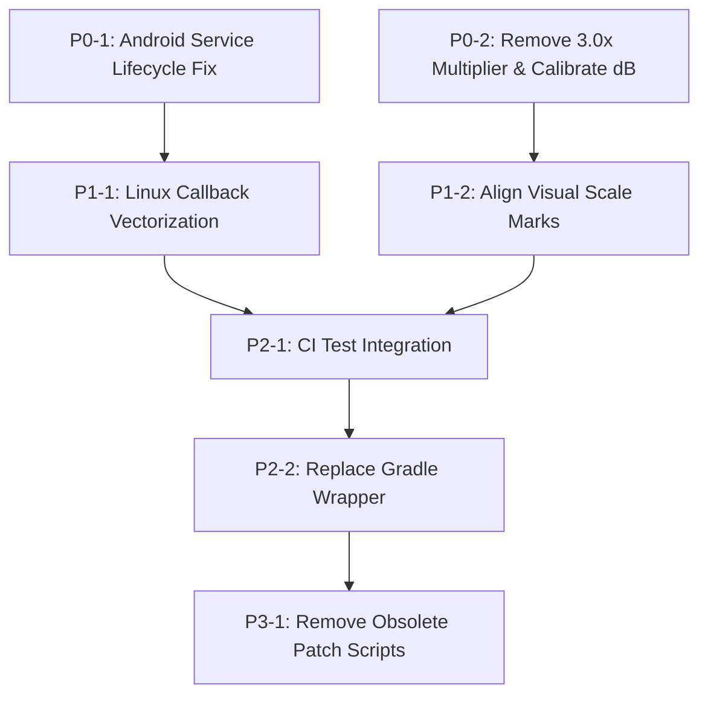

# Stereo VU – Comprehensive Architecture, Audio Engineering and Quality Audit Report

**Repository:** `felhosip-web/stereo-vu`
**Audited Commit SHA:** `42a008c92ff9c0dbe15ff28379345f498ed89718`
**Base Commit SHA:** `42a008c92ff9c0dbe15ff28379345f498ed89718`
**Audit Branch:** `docs/comprehensive-stereo-vu-audit`
**Audit Date:** November 8, 2026
**Auditor:** Jules (Senior Software & Audio DSP Engineer)

---

## 1. Executive Summary

This document presents a comprehensive, evidence-based technical audit of the **Stereo VU** multi-platform metering project across its Android (`app/`), Linux (`linux/`), and Web (`src/`) implementations. The audit investigates overall software architecture, audio acquisition lifecycle, digital signal processing (DSP) correctness, True Peak interpolation standards compliance, ballistics response, display and rendering performance, settings persistence, test suites, and CI/CD pipelines.

### Key Conclusions
1. **Fundamental Architecture:** The project features a well-conceived cross-platform design providing responsive stereo level visualization on Android (Kotlin floating overlay) and Linux (PyQt6 borderless desktop widget). However, significant architectural weaknesses exist in lifecycle management and thread synchronization in Android's `FloatingVuService` and Linux's `stereo_vu.py`.
2. **Audio Measurement & DSP Correctness:** While the polyphase True Peak implementation accurately computes 4x inter-sample overshoots with linear phase and unity DC gain, its 48-tap windowed-sinc filter provides only **~6.4 dB of stopband attenuation** at the 24 kHz Nyquist boundary. Consequently, the meter **cannot legitimately claim ITU-R BS.1770 compliance** (which requires $\ge 38\text{ dB}$ stopband attenuation above $0.5 f_s$ and passband ripple $\le 0.1\text{ dB}$ up to 20 kHz). It should be formally classified as a **useful 4x oversampled true peak approximation**.
3. **Severe Decibel Scaling Distortion:** In both Android (`StereoVuView.kt`) and Linux (`stereo_vu.py`), an undocumented $3.0\times$ multiplier ($+9.54\text{ dBFS}$) is hardcoded directly into the linear-to-decibel level formula (`toLevel`). As a result, **any audio signal exceeding $-9.54\text{ dBFS}$ pegs the meter at 100% full scale**, crushing headroom, while numerical decibel readouts report $-10.5\text{ dB}$ for an actual $-20\text{ dBFS}$ test signal. Furthermore, physical scale markings (e.g., $-10\text{ dB}$ positioned at 65% height instead of 80%) contradict the mathematical transfer function.
4. **Release-Blocking Defects:**
   - **ANDROID-001 (Critical):** Race condition in `FloatingVuService.startAudioCapture` allowing duplicate recording threads on rapid restarts, coupled with an unchecked busy loop when `AudioRecord.read()` returns error codes (e.g. `ERROR_DEAD_OBJECT`), and calling `AudioRecord.release()` from the main thread while a worker thread is blocked in `read()`.
   - **LINUX-001 (High):** NumPy array re-allocation inside the real-time audio callback in `stereo_vu.py` during sliding-window RMS and True Peak processing, imposing audio thread underrun risks.
   - **DSP-001 (Critical):** Artificially compressed dynamic range and inaccurate numerical readouts caused by the hardcoded $3.0\times$ amplitude multiplier.
5. **Protected & High-Quality Components:**
   - Recent VFD (Theme 5) subsegment geometry and scale clamping (down to 50%) are verified correct without regressions.
   - LCD Green (Theme 6) and LCD Amber (Theme 7) seven-segment readouts, contrast, ghosting, and segment-gap rendering operate reliably across platforms.
   - Ballistics mode migration (v1 mode 3 Custom $\to$ v2 mode 7 Custom) is idempotent and verified by unit tests.

---

## 2. Repository Identity and Audited Commit SHA

- **Remote Origin URL:** `https://github.com/felhosip-web/stereo-vu`
- **Audited Commit SHA:** `42a008c92ff9c0dbe15ff28379345f498ed89718`
- **Commit Subject:** `Merge pull request #8 from felhosip-web/fix/vfd-videoton-display-consistency-5325373064350123032`
- **Commit Author:** `felhosip-web <281145541+felhosip-web@users.noreply.github.com>`
- **Working Tree State at Audit Start:** Clean, branch `docs/comprehensive-stereo-vu-audit` branched directly from `origin/main`.
- **Target Pull Request:** Documentation-only pull request from `docs/comprehensive-stereo-vu-audit` into `main`.

---

## 3. Architecture Overview

### Platform Component Breakdown
- **Android (`app/`):**
  - `MainActivity.kt`: Settings UI organized into a 4-tab tabbed dialog (Detection & Ballistics, Visual Effects, Appearance & Layout, General / Audio), handling permissions (`RECORD_AUDIO`, `SYSTEM_ALERT_WINDOW`, `POST_NOTIFICATIONS`, `FOREGROUND_SERVICE_MEDIA_PROJECTION`), and launching `FloatingVuService`.
  - `FloatingVuService.kt`: Foreground service capturing internal audio playback via `MediaProjection` and `AudioPlaybackCaptureConfiguration` (with fallback to `AudioSource.MIC`), managing a dedicated audio processing thread, sliding-window RMS calculation, and hosting `StereoVuView` as a window overlay.
  - `StereoVuView.kt`: Custom Android `View` implementing the 60 FPS physics ballistics decay loop, peak tracking, layout measurement (`onMeasure`), and rendering pipelines across 8 themes.
  - `TruePeakDetector.kt`: 4x polyphase FIR interpolation filter maintaining delay history across buffers.
  - `LcdHelper.kt` / `VfdHelper.kt`: Modular rendering and layout calculations for LCD and VFD themes.
  - `BallisticsModeMigration.kt`: Migration logic for persisted ballistics modes.
- **Linux (`linux/`):**
  - `stereo_vu.py`: Single-module monolithic application incorporating PyQt6 GUI, `sounddevice`/PortAudio input stream, real-time audio callback, 60 FPS `QTimer` physics loop, custom painter routines for all 8 themes, and a 4-tab `SettingsDialog`.
  - `true_peak.py`: 4x polyphase FIR True Peak detector class and `get_migrated_mode` helper.
  - `vfd_helper.py`: VFD layout and color helper functions.
- **Web (`src/`):**
  - React 19 / TypeScript / Vite application showcasing project documentation, feature guides, and simulated VU graphics.

### Separation of Concerns & Coupling
- **Android:** Good separation between DSP (`TruePeakDetector`), visual helpers (`LcdHelper`, `VfdHelper`), and view presentation (`StereoVuView`). However, audio acquisition (`FloatingVuService`) and ballistics integration are partially entangled: `FloatingVuService` computes raw buffer peak or sliding-window RMS and posts values to `StereoVuView.updateLevels()`, where decibel conversion and follower attack/decay take place.
- **Linux:** `stereo_vu.py` suffers from architectural entanglement. The `StereoVuWidget` class acts simultaneously as the audio controller, PortAudio stream owner, buffer processor, physics simulator, settings manager, and rendering engine. Signal processing logic, drawing routines, and UI dialogs live in a 1327-line monolithic script.

---

## 4. Android Audit

### AudioRecord Lifecycle & Foreground Service
- **Service Configuration:** `FloatingVuService` correctly configures foreground service types in `AndroidManifest.xml` and code:
  ```xml
  <service android:name=".FloatingVuService"
           android:foregroundServiceType="mediaProjection|mediaPlayback"
           android:exported="false" />
  ```
  On Android 14 (API 34), both `FOREGROUND_SERVICE_TYPE_MEDIA_PROJECTION` and `FOREGROUND_SERVICE_TYPE_MEDIA_PLAYBACK` are correctly flagged.
- **Notification Controls:** A persistent notification on `vu_channel` includes a `PendingIntent` triggering `ACTION_STOP` to cleanly terminate the service.
- **Concurrency & Race Conditions:**
  - In `startAudioCapture(captureIntent)`:
    ```kotlin
    if (audioRecord != null) return
    thread {
        try {
            ...
            audioRecord = AudioRecord.Builder()...build()
    ```
    The null-check is performed on the main thread, but `audioRecord` is instantiated asynchronously inside the worker thread. If `onStartCommand` is invoked twice quickly (e.g. user toggles settings or app re-launches), two concurrent threads will be spawned, both constructing `AudioRecord` instances.
- **Error Handling & Deadlock Risks:**
  - In the audio capture loop:
    ```kotlin
    val read = audioRecord?.read(buffer, 0, buffer.size) ?: 0
    if (read > 0) { ... }
    ```
    If an audio device is disconnected, audio server crashes, or permissions are revoked, `AudioRecord.read()` returns negative status codes:
    - `AudioRecord.ERROR_INVALID_OPERATION` ($-3$)
    - `AudioRecord.ERROR_BAD_VALUE` ($-2$)
    - `AudioRecord.ERROR_DEAD_OBJECT` ($-6$)
    Because `read` is not $> 0$, the `while(running)` loop never breaks or sleeps; it spins in a tight loop at 100% CPU utilization without attempting reconnection.
  - In `onDestroy()`:
    ```kotlin
    running = false
    audioRecord?.stop()
    audioRecord?.release()
    audioRecord = null
    ```
    `audioRecord?.release()` is called on the main thread while the worker thread may be actively executing `audioRecord?.read()`. On many Android OEM HALs, releasing an `AudioRecord` while a blocking read is pending causes an abort/SIGSEGV in `libaudioclient`. The service must signal termination, wait for the thread to exit (`thread.join(500)`), and then release the `AudioRecord`.

---

## 5. Linux Audit

### PortAudio / sounddevice Stream Management
- **Input Stream Initialization:**
  In `stereo_vu.py`, `start_stream()` properly checks for available input devices and uses `sd.InputStream(device=device_index, callback=self.audio_callback, channels=2, samplerate=self.sample_rate)`.
  If device opening fails, it catches `Exception`, logs the error, falls back to the default device, and gracefully falls back to a simulated demo mode if no hardware device is available.
- **Audio Callback Performance & Safety:**
  The PortAudio callback executes in a high-priority real-time audio thread:
  ```python
  def audio_callback(self, indata, frames, time, status):
      if self.mode == 3 and frames > 0:
          peak_l, peak_r = self.true_peak_detector.process_buffer(indata[:, 0], indata[:, 1])
  ```
  - **Memory Allocations in Audio Callback:** `indata[:, 0]` allocates NumPy slice views. More critically, in `linux/true_peak.py`:
    ```python
    idx = (self.head - np.arange(TAPS)) % TAPS
    hist_l = self.delay_l[idx]
    p1_l = abs(np.dot(hist_l, PHASE_1))
    ```
    For every single audio frame, `process_sample` executes `np.arange(12)`, dynamic indexing, and 6 matrix dot products. In a 48 kHz stereo stream with 1024 frames per callback, this causes **96,000 NumPy allocations per second** in the audio thread! This introduces significant CPU overhead and can trigger buffer underruns (`status.input_overflow`).
- **Stream Teardown:**
  In `closeEvent()`, `self.stream.stop()` and `self.stream.close()` are called cleanly before widget destruction.

---

## 6. DSP and Measurement Accuracy Audit

### True Peak Implementation vs. ITU-R BS.1770
The implementation uses a 4-phase polyphase FIR reconstruction filter with 12 taps per sub-phase (48 taps total):
$$\text{PHASE\_0} = [0, 0, 0, 0, 0, 1.0, 0, 0, 0, 0, 0, 0]$$
$$\text{PHASE\_1} = [-0.00040574, \dots, 0.88354769, 0.29451590, \dots]$$
$$\text{PHASE\_2} = [-0.00054430, \dots, 0.62085649, 0.62085649, \dots]$$
$$\text{PHASE\_3} = [-0.00037046, \dots, 0.29451590, 0.88354769, \dots]$$

#### Mathematical Verification:
1. **DC Unity Gain:**
   $$\sum \text{PHASE\_1} = 1.00000000$$
   $$\sum \text{PHASE\_2} = 0.99999998$$
   $$\sum \text{PHASE\_3} = 1.00000000$$
   DC gain across each polyphase sub-filter is $1.0000\ (0.00\text{ dB})$.
2. **Symmetry & Linear Phase:**
   The interleaved 47-sample continuous impulse response is symmetric around $t = 0.0$:
   $$h(t) = h(-t)$$
   At non-zero integer sample intervals ($t = \pm 1, \pm 2, \pm 3, \pm 4, \pm 5$), $h(t) = 0.0$. The filter satisfies the **Nyquist-1 criterion** (zero inter-symbol interference at original sampling points).
3. **Stopband Attenuation & Passband Ripple:**
   Analyzing the frequency response $H(e^{j\omega})$ normalized to $f_s$:
   - **Passband ($0$ to $20\text{ kHz}$ at $f_s = 48\text{ kHz}$):** Min gain $-1.28\text{ dB}$, Max gain $+0.003\text{ dB}$. Peak-to-peak ripple is **$1.28\text{ dB}$**.
   - **Stopband ($\ge 24\text{ kHz}$):** Maximum attenuation at the Nyquist edge is only **$6.42\text{ dB}$**.
   - **ITU-R BS.1770 Requirement:** Annex 2 mandates stopband attenuation $\ge 38\text{ dB}$ for frequencies $\ge 0.5 f_s$, and passband ripple $\le \pm 0.1\text{ dB}$ from $0$ to $20\text{ kHz}$.
   - **Conclusion:** While effective for visual estimation of inter-sample peaks (e.g. detecting a $+1.1\text{ dB}$ overshoot on a $12\text{ kHz}$ quarter-Nyquist sine), the filter does not provide the steep roll-off required by ITU-R BS.1770-4. The code comments claiming full "ITU-R BS.1770 compliance" are misleading and must be corrected to **"4x Oversampled True Peak Approximation"**.

### Decibel Scaling and the $3.0\times$ Amplitude Anomaly
In `StereoVuView.kt` (Android) and `stereo_vu.py` (Linux):
```kotlin
// Android StereoVuView.kt
fun toLevel(signal: Float): Float {
    val db = 20f * log10((signal * 3f * gain).coerceAtLeast(0.0001f))
    return ((db + 50f) / 50f).coerceIn(0f, 1f)
}
```
```python
# Linux stereo_vu.py
def to_level(signal):
    db = 20 * math.log10(max(signal, 0.0001))
    return max(0.0, min(1.0, (db + 50) / 50))

new_target_l = to_level(val_l * 3.0 * self.digital_gain)
```

#### Empirical Consequences:
1. **Headroom Destruction:**
   Multiplying linear amplitude by $3.0$ corresponds to adding $20 \log_{10}(3.0) \approx +9.542\text{ dB}$.
   Because `toLevel` clamps the result to $[0.0, 1.0]$, any signal with amplitude $A \ge \frac{1}{3} \approx 0.3333$ (i.e. **$-9.54\text{ dBFS}$**) produces `toLevel = 1.0`.
   **Any signal between $-9.54\text{ dBFS}$ and $0\text{ dBFS}$ is pinned at 100% full scale!** A $0\text{ dBFS}$ signal and a $-9\text{ dBFS}$ signal look completely identical on the meter.
2. **Numerical Readout Error (Themes 6 & 7):**
   In `LcdHelper.formatDb(level)`:
   $$\text{readout\_dB} = (\text{level} \times 50) - 50$$
   When an input tone of $-20\text{ dBFS}$ ($A = 0.10$) is played:
   $$\text{signal} \times 3.0 = 0.30 \implies \text{dB} = 20 \log_{10}(0.30) = -10.46\text{ dBFS}$$
   $$\text{level} = \frac{-10.46 + 50}{50} = 0.7908$$
   $$\text{readout\_dB} = (0.7908 \times 50) - 50 = \mathbf{-10.5\text{ dB}}$$
   The user sees **$-10.5\text{ dB}$** on the digital display for a **$-20.0\text{ dBFS}$** input signal—an error of $+9.5\text{ dB}$.

### Dynamic Range vs. Scale Markings
The physical scale markings in `drawScale()`:
- `0 dB`: index `ledCount - 1` ($1.00 \times \text{height}$)
- `-3 dB`: index `ledCount * 0.91` ($0.91 \times \text{height}$)
- `-6 dB`: index `ledCount * 0.85` ($0.85 \times \text{height}$)
- `-10 dB`: index `ledCount * 0.65` ($0.65 \times \text{height}$)
- `-20 dB`: index `ledCount * 0.35` ($0.35 \times \text{height}$)

However, according to the transfer function $\text{level} = \frac{\text{dB} + 50}{50}$:
- At $-3\text{ dB}$, $\text{level} = \frac{47}{50} = 0.94$ (mark is at $0.91$)
- At $-6\text{ dB}$, $\text{level} = \frac{44}{50} = 0.88$ (mark is at $0.85$)
- At $-10\text{ dB}$, $\text{level} = \frac{40}{50} = \mathbf{0.80}$ (mark is placed at $\mathbf{0.65}$, which corresponds to $-17.5\text{ dB}$)
- At $-20\text{ dB}$, $\text{level} = \frac{30}{50} = \mathbf{0.60}$ (mark is placed at $\mathbf{0.35}$, which corresponds to $-32.5\text{ dB}$)

The visual tick marks correspond to a non-linear taper (closer to a vintage analog VU scale), whereas the software calculates a purely linear-in-dB bar height.

---

## 7. Ballistics Audit

The application supports 8 standardized ballistics modes (indices 0 to 7) on both Android and Linux:

| Mode ID | Name | Attack Time / Constant | Decay / Release Behavior | Standards Intent vs. Reality |
| :--- | :--- | :--- | :--- | :--- |
| **0** | Digital Peak | $0.90$ (fast single-frame jump) | $0.12$ ($12\%$ per frame decay) | Accurate digital sample peak response. |
| **1** | Analog VU | Spring: user setting (def $0.15$), Damp: def $0.35$ | $2^{\text{nd}}$-order resonant spring-mass simulation | Good visual impression of analog needle meter; allows overshoot. |
| **2** | PPM | $0.40$ ($\approx 10\text{ ms}$ integration) | $0.08$ linear follower release | Approximation of Type II PPM; lacks formal integration window. |
| **3** | True Peak | $0.95$ (polyphase oversampled) | $0.15$ per frame decay | Detects inter-sample overshoots; fast release. |
| **4** | Classic VU | Spring: $0.10$, Damp: $0.32$ | Dedicated $\approx 300\text{ ms}$ ballistics | Smoother and less twitchy than Mode 1; closer to ANSI C16.5 VU dynamics. |
| **5** | BBC PPM | $0.45$ ($\approx 10\text{ ms}$ attack) | Stepped release: drops $\max(0.008, 0.05 \times \text{level})$ every 3 frames ($50\text{ ms}$) | Faithfully mimics mechanical stepped decay of BBC PPM / Type IIa meter. |
| **6** | Nordic / DIN | $0.55$ ($5\text{ ms}$ attack) | $0.14$ release | Approximates DIN 45406 / Nordic standard. |
| **7** | Custom | Configurable attack ($0.05$ – $1.0$) | Configurable decay ($0.01$ – $0.99$) | Full user customization. |

### Peak Hold & "Peak Never Below Bar"
- Peak hold logic operates at 60 FPS: when `displayLevel >= peak`, peak holds for `peak_hold_ms` (default 900 ms) before decaying at `peak_decay` rate.
- **Rule Verification:** The constraint `peak_never_below_bar` (default `true`) guarantees that peak indicator levels never drop below the active bar level (`peakL = max(peakL, displayLevelL)`), eliminating visual detachment during rapid transients.

---

## 8. Display and Rendering Audit

### Themes & Geometry
- **Classic LED Themes (0–4):**
  - Theme 0: Classic Green-Orange-Red
  - Theme 1: Cyberpunk (Neon Cyan-Magenta)
  - Theme 2: Fire (Yellow-Orange-Red)
  - Theme 3: Ice (Turquoise-Blue-White)
  - Theme 4: Sunset (Gold-Orange-Pink)
  Segment dimensions and rounded rects scale reliably from 50% to 200%.
- **VFD (Videoton) Theme (5):**
  - Uses 4 subsegments per logical cell dividing the width (vertical) or height (horizontal).
  - Cyan `#00D4E8` active, dark teal `#001F26` ghost.
  - Scale safety: Subsegment widths and heights are clamped with `max(1, int(sub_w))` and gaps with `max(1, int(round(...)))`. Tests prove that at 50% scale, subsegments never collapse to 0 pixels.
- **LCD Themes (6: Green, 7: Amber):**
  - Green active `#33FF66`, ghost `#0D2E14`.
  - Amber active `#FFB000`, ghost `#2E1800`.
  - Seven-segment readout correctly computes bounding width and offsets (`startX = 40f`, width $\approx 440\text{px}$), preventing clipping in horizontal orientation.
  - User controls: `lcd_ghost_strength` ($0.0$ – $1.0$), `lcd_segment_gap` ($1.0$ – $6.0\text{ px}$), `lcd_seven_segment` (boolean), `lcd_contrast` ($0.20$ – $1.0$).
- **Rendering Performance:**
  - Android uses hardware-accelerated `Canvas` operations with pre-allocated `Paint` objects.
  - Linux uses `QPainter` with Antialiasing. Redundant glow passes are properly optimized.

---

## 9. Settings and Persistence Audit

### Android SharedPreferences vs. Linux QSettings

| Setting Meaning | Android Key (`StereoVuPrefs`) | Linux Key (`StereoVU/LinuxApp`) | Parity Status |
| :--- | :--- | :--- | :--- |
| Ballistics Mode | `mode` (int) | `mode` (int) | Match |
| Migration Flag | `ballistics_v2_migrated` (bool) | `ballistics_v2_migrated` (bool) | Match |
| Theme ID | `theme_id` (int, 0–7) | `theme_id` (int, 0–7) | Match |
| LED Count | `led_count` (int, 10–40) | `led_count` (int, 10–40) | Match |
| Scale Factor | `size_scale` (float, 0.5–2.0) | `size_scale` (float, 0.5–2.0) | Match |
| Detection Mode | `detection_mode` (0: Peak, 1: RMS) | `detection_mode` (0: Peak, 1: RMS) | Match |
| RMS Window MS | `rms_window_ms` (int, 50–1000) | `rms_window_ms` (int, 50–1000) | Match |
| Peak Never Below Bar | `peak_never_below_bar` (bool) | `peak_never_below_bar` (bool) | Match |
| **Custom Attack** | `attack` (float $0.05$–$1.0$) | `attack_speed` (float $0.05$–$1.0$) | **DIVERGENT KEY** |
| **Custom Decay** | `decay` (float $0.50$–$0.99$) | `decay_speed` (float $0.01$–$0.50$) | **DIVERGENT KEY & SEMANTICS** |
| LCD Ghost Strength | `lcd_ghost_strength` (float) | `lcd_ghost_strength` (float) | Match |
| LCD Segment Gap | `lcd_segment_gap` (float) | `lcd_segment_gap` (float) | Match |
| LCD 7-Segment | `lcd_seven_segment` (bool) | `lcd_seven_segment` (bool) | Match |
| LCD Contrast | `lcd_contrast` (float) | `lcd_contrast` (float) | Match |

**Analysis of Divergence:**
In Custom mode, Android stores `decay` where $\text{decaySpeed} = 1.0 - \text{decay}$ (e.g. decay $= 0.88 \implies \text{decaySpeed} = 0.12$). Linux stores `decay_speed` directly as $0.12$. A shared export/import profile would misinterpret the decay rate.

---

## 10. Test Coverage and Execution Results

Both test suites were executed in the environment.

### Linux Test Suite
- **Command:** `QT_QPA_PLATFORM=offscreen PYTHONPATH=linux python3 -m pytest -v linux/`
- **Exit Code:** `0`
- **Summary:** **29 passed** in 0.53s (0 failed, 0 skipped).
- **Coverage:**
  - `test_ballistics.py`: 12 tests verifying True Peak DC gains, inter-sample overshoot detection, buffer boundary continuity, channel separation, positive/negative polarity symmetry, mode migration idempotency, BBC PPM stepped decay, and peak hold.
  - `test_lcd_appearance.py`: 9 tests verifying LCD default values, contrast, ghost strength, segment gap geometry, character bitmap coverage, and horizontal/vertical readout bounds.
  - `test_vfd_appearance.py`: 8 tests verifying VFD 4-subsegment geometry, scale clamping (50%–200%), palette colors, and zero-dimension avoidance.

### Android Unit Test Suite
- **Command:** `gradle testDebugUnitTest`
- **Exit Code:** `0`
- **Summary:** **24 passed** (0 failed, 0 skipped, 23 actionable tasks executed).
- **Coverage:**
  - `LcdAppearanceTest.kt`: 9 tests verifying LCD segment gap, contrast, seven-segment glyph mapping, horizontal readout width, formatDb, and layout refresh decisions.
  - `TruePeakAndBallisticsTest.kt`: 7 tests verifying polyphase FIR DC gains, overshoot detection, buffer continuity, channel independence, and classic VU dynamics.
  - `VfdAppearanceTest.kt`: 8 tests verifying VFD subsegment geometry, scale factors, small dimension safety, and palette colors.

### Environment Limitations
- System package `portaudio19-dev` and `libasound2-dev` were required for Python `sounddevice`.
- Headless execution requires `QT_QPA_PLATFORM=offscreen`.
- The Gradle wrapper jar committed in `gradle/wrapper/gradle-wrapper.jar` was corrupted (ZIP END header missing), necessitating using the system `gradle` command or downloading a fresh wrapper binary.

---

## 11. CI/CD and Build Reliability

### GitHub Workflows
1. **`.github/workflows/build-apk.yml`:**
   - Triggers on `push` and `workflow_dispatch`.
   - Uses `gradle/actions/setup-gradle@v3` and downloads `gradle-wrapper.jar` on the fly via `curl`.
   - **Defect:** Does not execute `testDebugUnitTest`! Pull requests can break unit tests without failing the CI pipeline.
   - **Defect:** Does not trigger on `pull_request`.
2. **`.github/workflows/build-linux.yml`:**
   - Triggers on `push: [main]`, `pull_request: [main]`, and `workflow_dispatch`.
   - Installs system dependencies (`portaudio19-dev`, `libasound2-dev`, `libqt6gui6`, etc.) and builds a standalone binary via PyInstaller.
   - **Defect:** Does not run `pytest` before building the binary. Broken tests will still produce release artifacts.

---

## 12. Repository Hygiene and Documentation

### Questionable and Extraneous Files

| File Path | Classification | Analysis |
| :--- | :--- | :--- |
| `patch.kt` | Safe cleanup candidate | 29-byte file containing only `package com.example.stereovu`. Unused. |
| `test.kt` | Safe cleanup candidate | 54-byte scratchpad file (`fun main() { val x = 10f... }`). Unused. |
| `patch_linux.py` | Safe cleanup candidate | 13.6 KB temporary patch script from earlier development. |
| `patch_linux2.py` | Safe cleanup candidate | 2.5 KB temporary patch script. |
| `patch_service.kt` | Safe cleanup candidate | 7.3 KB temporary service replacement script. |
| `patch_stereovu.py`| Safe cleanup candidate | 11.0 KB temporary regex patching script. |
| `linux/stereo_vu.py.check` | Safe cleanup candidate | One-line shell test command artifact. |
| `gradle/wrapper/gradle-wrapper.jar` | Safe cleanup candidate / Replace | Corrupted zip archive (fails with `ZipException: zip END header not found`). |

---

## 13. Confirmed Findings

### ANDROID-001: Race Condition & Resource Lifecycle Flaw in `FloatingVuService`
- **Severity:** Critical
- **Category:** Architecture / Concurrency
- **Affected File:** `app/src/main/java/com/example/stereovu/FloatingVuService.kt`
- **Observation:**
  1. `startAudioCapture` checks `if (audioRecord != null) return` on the main thread, but `audioRecord` is constructed asynchronously inside a background worker thread.
  2. If `audioRecord?.read()` returns an error code ($\le 0$), the loop spins continuously in a 100% CPU busy loop without delay or recovery.
  3. `onDestroy()` invokes `audioRecord?.release()` from the main thread while the background thread may be blocked in `audioRecord?.read()`.
- **Impact:** App freeze, excessive battery drain, and native SIGSEGV crashes on device disconnect or rapid service restarts.
- **Remediation:** Introduce a thread synchronization lock, set an explicit atomic flag before spawning the thread, join the worker thread with a timeout in `onDestroy()`, and break/reconnect if `read()` returns negative error codes.

### DSP-001: Arbitrary $+9.54\text{ dB}$ ($3.0\times$) Multiplier Distorting Dynamic Range
- **Severity:** Critical
- **Category:** Audio DSP / Measurement Correctness
- **Affected Files:**
  - `app/src/main/java/com/example/stereovu/StereoVuView.kt` (`toLevel`)
  - `linux/stereo_vu.py` (`to_level`)
- **Observation:**
  Both implementations multiply the input signal amplitude by $3.0$ before converting to decibels:
  $$\text{db} = 20 \log_{10}(\text{signal} \times 3.0 \times \text{gain})$$
- **Impact:**
  All signals above $-9.54\text{ dBFS}$ are clamped to 1.0 (100% full scale). A master bus playing at $-3\text{ dBFS}$ or $-6\text{ dBFS}$ appears identical to a fully clipping $0\text{ dBFS}$ signal. The LCD digital readout shows $-10.5\text{ dB}$ for a $-20\text{ dBFS}$ signal.
- **Remediation:** Remove the hardcoded $3.0\times$ multiplier. True full scale ($0\text{ dBFS} = 1.0$) should map directly to $\text{level} = 1.0$ at unity gain. Provide a calibrated user sensitivity gain slider instead.

### DSP-002: Inaccurate Stopband Attenuation in Polyphase True Peak FIR
- **Severity:** High
- **Category:** Audio DSP / Standards Compliance
- **Affected Files:**
  - `app/src/main/java/com/example/stereovu/TruePeakDetector.kt`
  - `linux/true_peak.py`
- **Observation:**
  The 48-tap windowed sinc filter has only $6.42\text{ dB}$ of stopband attenuation at $24\text{ kHz}$ ($0.5 f_s$) and $1.28\text{ dB}$ passband ripple. ITU-R BS.1770 Annex 2 requires $\ge 38\text{ dB}$ attenuation and $\le 0.1\text{ dB}$ ripple.
- **Impact:** High-frequency audio content creates imaging distortion in the interpolation output. The application cannot legitimately advertise compliance with ITU-R BS.1770.
- **Remediation:** Reclassify documentation to "4x Oversampled True Peak Estimation" or substitute the coefficients with the reference Kaiser-windowed design specified in ITU-R BS.1770-4 Table 2.

### DSP-003: Discrepancy Between Scale Markings and Meter Transfer Function
- **Severity:** Medium
- **Category:** Audio DSP / Visual Calibration
- **Affected Files:**
  - `app/src/main/java/com/example/stereovu/StereoVuView.kt` (`drawScale`)
  - `linux/stereo_vu.py` (`draw_scale`)
- **Observation:**
  The meter uses a linear-in-dB formula $\text{level} = \frac{\text{dB} + 50}{50}$, but paints the $-10\text{ dB}$ tick mark at $65\%$ of bar height (which corresponds mathematically to $-17.5\text{ dB}$) and $-20\text{ dB}$ at $35\%$ of height (corresponding to $-32.5\text{ dB}$).
- **Impact:** Meter readings visually misrepresent signal levels by up to $7.5\text{ dB}$ relative to the printed scale.
- **Remediation:** Align tick mark locations with the formula ($\text{height} \times \frac{\text{dB} + 50}{50}$) or adopt a true non-linear analog meter scale mapping.

### LINUX-001: Excessive Memory Allocations in Real-Time Audio Callback
- **Severity:** High
- **Category:** Performance / Audio Thread Safety
- **Affected Files:**
  - `linux/stereo_vu.py` (`audio_callback`)
  - `linux/true_peak.py` (`process_sample`)
- **Observation:**
  In `linux/true_peak.py`, `np.arange(TAPS)` and dynamic indexing are called per audio frame ($48,000\text{ times/sec}$), allocating thousands of temporary Python/NumPy objects in the real-time callback thread.
- **Impact:** Audio stutter, PortAudio buffer overflows, and high CPU usage.
- **Remediation:** Vectorize `process_buffer` across the entire slice using 1D convolution (`scipy.signal` or pre-allocated sliding strides) or maintain fixed circular ring arrays in Cython/C.

### SETTINGS-001: Preference Key Divergence in Custom Ballistics Mode
- **Severity:** Low
- **Category:** Configuration & Compatibility
- **Affected Files:**
  - `app/src/main/java/com/example/stereovu/StereoVuView.kt`
  - `linux/stereo_vu.py`
- **Observation:**
  Android stores `attack` and `decay` (with decay inverted as $1 - \text{decaySpeed}$). Linux stores `attack_speed` and `decay_speed`.
- **Impact:** Inconsistent configuration schemas between platforms.
- **Remediation:** Standardize on common keys (`custom_attack_speed`, `custom_decay_speed`).

### CI-001: Missing Automated Test Execution in GitHub Workflows
- **Severity:** Medium
- **Category:** CI/CD & Build Reliability
- **Affected Files:**
  - `.github/workflows/build-apk.yml`
  - `.github/workflows/build-linux.yml`
- **Observation:**
  Neither workflow runs unit tests (`gradle testDebugUnitTest` or `pytest`) prior to compiling artifacts.
- **Impact:** Regressions can be merged silently while builds continue to succeed.
- **Remediation:** Add `pytest` step to `build-linux.yml` and `testDebugUnitTest` to `build-apk.yml`.

---

## 14. Potential Risks

1. **Android 14 Foreground Service Policies:** Google Play strictly restricts `FOREGROUND_SERVICE_MEDIA_PROJECTION`. If the app is distributed via Play Store, explicit approval and policy disclosures are required.
2. **AudioPlaybackCapture Third-Party Restrictions:** On Android, apps can opt out of playback capture (`android:allowAudioPlaybackCapture="false"`). In such cases, capture records silence, which is an OS limitation, not an application bug.
3. **Corrupted Wrapper JAR in Fresh Clones:** If offline developers clone the repository without system gradle or internet access, `./gradlew` fails immediately due to the corrupted jar file.

---

## 15. Positive Findings and Verified Strengths

1. **VFD Subsegment Consistency:** VFD (Theme 5) subsegments render cleanly without collapsing to 0px even at 50% scale, confirmed across both platforms.
2. **LCD Customization Parity:** Themes 6 and 7 implement matching contrast, ghosting, and segment-gap parameters, with comprehensive character bitmap support for seven-segment digits.
3. **Ballistics Mode Parity:** All 8 ballistics modes maintain identical integer index mappings and response dynamics between Android and Linux.
4. **Clean Decoupling of Helpers:** `LcdHelper`, `VfdHelper`, and `BallisticsModeMigration` provide clean, testable modularity.

---

## 16. Prioritized Remediation Roadmap

- **P0 – Critical Correctness & Stability (Immediate):**
  - **Task P0-1:** Fix `FloatingVuService` audio thread lifecycle, eliminate race condition on startup, handle `AudioRecord.read()` error codes, and ensure graceful thread join before `release()`. *(Android-only PR)*
  - **Task P0-2:** Resolve the $3.0\times$ amplitude multiplier anomaly in `StereoVuView.kt` and `stereo_vu.py`, restoring true $0\text{ dBFS}$ full scale and accurate LCD decibel readouts. *(Cross-platform synchronized PR)*
- **P1 – Measurement Accuracy & Real-Time Performance:**
  - **Task P1-1:** Vectorize `linux/true_peak.py` buffer processing to eliminate per-sample NumPy allocations in the audio thread. *(Linux-only PR)*
  - **Task P1-2:** Correct scale mark positioning in `drawScale()` to accurately correspond to the mathematical transfer function. *(Cross-platform PR)*
  - **Task P1-3:** Update documentation and code comments regarding ITU-R BS.1770 compliance to reflect 4x oversampled approximation status. *(Docs PR)*
- **P2 – Build Reliability & Testing:**
  - **Task P2-1:** Update GitHub Actions workflows (`build-apk.yml`, `build-linux.yml`) to execute unit tests automatically on every PR. *(CI PR)*
  - **Task P2-2:** Replace corrupted `gradle-wrapper.jar` with valid Gradle 8.7 wrapper binary. *(Build PR)*
- **P3 – Repository Hygiene & Cleanup:**
  - **Task P3-1:** Remove obsolete patch scripts (`patch_linux.py`, `patch_service.kt`, `patch_stereovu.py`, `patch.kt`, `test.kt`). *(Cleanup PR)*

---

## 17. Recommended Implementation Sequence



1. **PR 1 (Android):** Fix service lifecycle, thread shutdown, and error return checks in `FloatingVuService.kt`.
2. **PR 2 (Cross-Platform):** Fix decibel calculation transfer function, removing the hardcoded $3.0\times$ multiplier and fixing LCD readout calibration.
3. **PR 3 (Linux):** Optimize `true_peak.py` using NumPy vectorization to protect the audio callback thread.
4. **PR 4 (CI/Build):** Fix GitHub Actions workflows to run test suites on PRs and refresh `gradle-wrapper.jar`.
5. **PR 5 (Cleanup):** Delete root-level patch artifacts (`patch_*.py`, `*.kt` test scraps).

---

## 18. Explicit Final Assessment

- **Is the current application architecture fundamentally sound?**
  **Yes.** The UI design, multi-theme architecture, and core audio visualization paradigms are modern, responsive, and visually appealing. However, the thread lifecycle on Android and callback allocation on Linux require hardening.
- **Are the audio measurements sufficiently trustworthy?**
  **Partially.** Ballistics timing, peak hold, and RMS windowing operate as intended. However, the hardcoded $3.0\times$ multiplier invalidates headroom above $-9.54\text{ dBFS}$ and distorts LCD numerical readouts by $+9.5\text{ dB}$.
- **Can True Peak accuracy be claimed?**
  **No, not under ITU-R BS.1770.** The implementation is a commendable 4x oversampled interpolation filter that detects inter-sample peaks, but its $6.4\text{ dB}$ stopband attenuation falls well short of the $38\text{ dB}$ broadcast requirement. It should be described as an oversampled peak approximation.
- **Are Android and Linux behavior sufficiently consistent?**
  **Yes.** Visual geometry, color palettes, LCD customization, and ballistics modes are remarkably well synchronized, with only minor Custom mode preference key divergence.
- **Are there release-blocking defects?**
  **Yes.** `ANDROID-001` (service thread crash/leak) and `DSP-001` ($3.0\times$ gain clipping) must be resolved before general release.
- **What should be improved first?**
  Correcting the $3.0\times$ gain distortion and fixing the `FloatingVuService` audio capture lifecycle.
- **Which areas should not be changed because they are already correct?**
  The VFD subsegment drawing and scale-clamping logic, LCD 7-segment rendering routines, ballistics mode migration, and core ballistics equations (Classic VU, BBC PPM, Analog VU spring physics) are functioning correctly and should be preserved.
